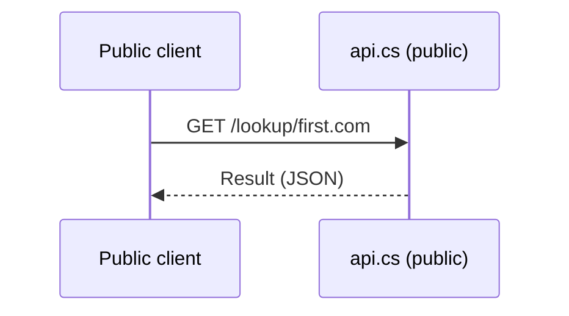
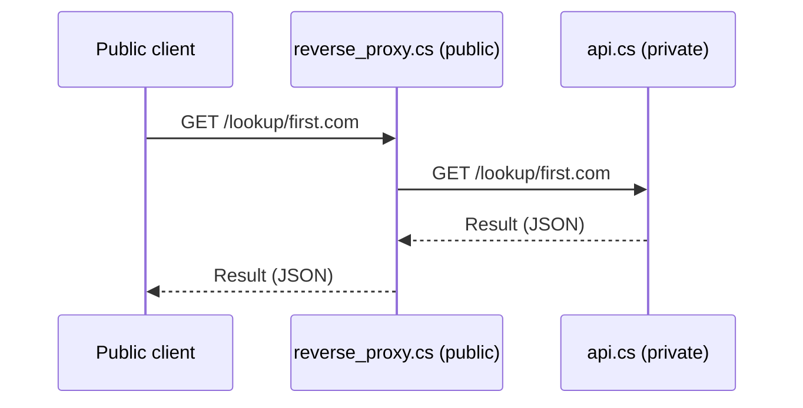
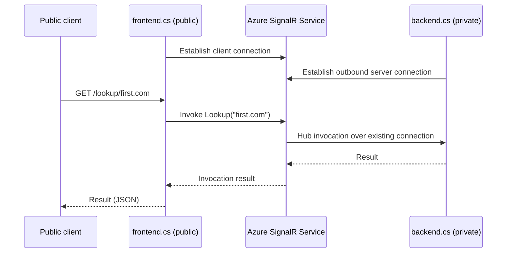

# Private backend APIs without inbound HTTP access

This walkthrough starts with a conventional API directly exposed to the public internet, then moves it behind a reverse proxy or a custom HTTP gateway. Finally, it replaces the frontend-to-backend HTTP connection with Azure SignalR Service, so the backend needs no inbound HTTP path from the frontend.

The examples are deliberately small. The data validation regex is illustrative, not a production-ready validator.

## 1. Traditional HTTP architectures

### Request flows

**Direct API:** the public client connects directly to the backend.



**Reverse proxy:** the public client connects to the proxy, which has HTTP access to a private backend.



**Custom proxy:** the network arrangement is the same as the above reverse proxy, but the frontend validates the inbound request data and constructs a new backend request.

### `api.cs` - backend API

This is the actual backend API: it declares a basic input-validation rule and returns a structured `Result`. It can be protected with authentication and other HTTP controls, but keeping the backend off the public internet reduces its direct exposure.

```csharp
#:sdk Microsoft.NET.Sdk.Web
#:property PublishAOT=false
using System.ComponentModel.DataAnnotations;

var builder = WebApplication.CreateBuilder();
builder.Services.AddValidation();

var app = builder.Build();
app.MapGet("/lookup/{name}", ([RegularExpression(@"\A[a-z0-9]{1,63}\.com\z")] string name) => 
    new Result(name, "Fred", "Smith")
);
app.Run("http://localhost:5302");

public record Result(string Domain, string FirstName, string LastName);
```

### `reverse_proxy.cs` - conventional reverse proxy

The public-facing proxy forwards only the configured `GET /lookup/{name}` route to the private API. YARP is used here, but NGINX or Azure API Management can follow the same architectural pattern. Further hardening can limit forwarded headers, query parameters and other request data.

```csharp
#:sdk Microsoft.NET.Sdk.Web
#:package Yarp.ReverseProxy@*
using Yarp.ReverseProxy.Configuration;

var builder = WebApplication.CreateBuilder();

builder.Services.AddReverseProxy().LoadFromMemory(
    [new() { RouteId = "lookup", ClusterId = "backend", Match = new() { 
        Path = "/lookup/{name}", 
        Methods = ["GET"] 
    }}],
    [new() { ClusterId = "backend", Destinations = new Dictionary<string, DestinationConfig> { ["api"] = new() { 
        Address = "http://localhost:5302/" 
    }}}]
);

var app = builder.Build();
app.MapReverseProxy();
app.Run("http://localhost:5301");
```

### `custom_proxy.cs` - application-level HTTP gateway

Instead of forwarding the original request, this gateway is intended to validate the input, create a fresh HTTP request to the backend, and deserialize the response into a known `Result` type. Unrelated inbound headers and request metadata are not automatically passed through.

The trade-off is more code and maintenance: the frontend's request and response contracts may need updating as the backend evolves.

```csharp
#:sdk Microsoft.NET.Sdk.Web
#:property PublishAOT=false
using System.ComponentModel.DataAnnotations;

var builder = WebApplication.CreateBuilder();
builder.Services.AddValidation();
builder.Services.AddHttpClient();

var app = builder.Build();
app.MapGet("/lookup/{name}", async ([RegularExpression(@"\A[a-z0-9]{1,63}\.com\z")] string name, HttpClient client) => 
    await client.GetFromJsonAsync<Result>("http://localhost:5302/lookup/" + name)
);
app.Run("http://localhost:5301");

public record Result(string Domain, string FirstName, string LastName);
```

### The common limitation

Both proxy approaches are established, potentially very secure patterns. However, **both require the frontend to have network access to the backend HTTP listener**.

If the frontend is fully compromised, an attacker may bypass its route restrictions or validation and use that network access to send arbitrary HTTP requests to the backend. Even without frontend compromise, HTTP traffic legitimately forwarded by a proxy can still exercise vulnerabilities in the backend web server or HTTP framework. A narrowly configured proxy reduces exposure; it does not remove this HTTP attack path.

## 2. An alternative: Azure SignalR Service

The final design removes the need for any **frontend-to-backend inbound HTTP connectivity**. The public frontend and private backend each connect *outbound* to Azure SignalR Service (in **Default** mode).  SignalR allows real-time messages to be send between the front-end and back-end.  Azure relays the message over the backend's existing service connection and returns the result along the same route.



**The backend does not need to accept HTTP requests from the frontend.** Its local hub route exists in the sample application, but production network controls must ensure that this listener is not reachable from the public frontend or other untrusted networks.

### `apphost.cs` - run the demonstration

The Aspire app host starts `backend.cs` and `frontend.cs` together and provides a dashboard for logs, metrics and distributed traces. It also supplies the Azure SignalR connection string to both processes. Run:

```text
aspire run
```

Aspire prompts for the connection string if it has not been configured and can offer to save it in user secrets. An existing Azure SignalR Service resource configured for **Default** mode is required.

### `backend.cs` - private API implementation

Most of the setup configures OpenTelemetry for the Aspire dashboard. The core is `ApiHub`, particularly:

```csharp
public async Task<Result> Lookup(string name)
```

Azure SignalR Service delivers hub invocations over the backend's outbound connection. `Lookup` validates the domain, simulates a lookup, logs the operation and returns a structured result. The sample includes an error case to demonstrate failure handling and tracing.  See ```backend.cs``` for full details.

### `frontend.cs` - public HTTP interface

The frontend connects directly to Azure SignalR Service and maintains a SignalR connection. For portability, this example shows how to sign a short-lived JWT using the connection string's access key rather than hiding token creation behind a .NET-specific SDK.  Microsoft provides the ```Microsoft.Azure.SignalR.Management``` nuget package to simplify generation of tokens, but we decided to implement a lower level approach that does not require a package to help anyone porting this code to other environments.

The key endpoint is `app.MapGet("/lookup/{name}", ...)`. It starts a `Domain.Lookup` tracing span, logs the operation, and calls `connection.InvokeAsync<Result>("Lookup", name)` to await the backend's response over Azure SignalR Service. It **never makes an HTTP request to the backend**. The .NET SignalR tracing instrumentation can correlate the frontend HTTP request with the backend hub invocation in the Aspire dashboard.

We added a ```RetryPolicy``` to ensure that the frontend will always attempt to reconnect to the backend and never give up.  We also added a simple extension method ```await connection.WaitUntilConnectedAsync(timeout: TimeSpan.FromSeconds(30));``` to wait for a valid connection for up to 30 seconds before sending the  request to the backend. 

The startup retry loop handles the initial connection attempt; automatic reconnection applies after a successful first connection.  See ```frontend.cs``` for full details.

The same concept shown here can be adapted to environments such as Cloudflare.  Note: SignalR is intended to maintain a long-lived connection and is not really suitable for Cloudflare workers.  It would be more appropriate to use a Cloudflare Durable Object to maintain the long lived connection.

## 3. The security benefit: containing frontend compromise

The key difference becomes clear when we assume that the public-facing frontend has been completely compromised:

| Architecture | What the compromised frontend can reach |
| --- | --- |
| Reverse or custom HTTP proxy | The backend HTTP listener, including the ability to attempt arbitrary HTTP requests, subject to network controls |
| Azure SignalR bridge | The Azure SignalR messaging interface, **not** the backend HTTP listener, provided network isolation is enforced |

This is **defence in depth**. The objective is not merely to validate or restrict what a healthy proxy forwards; it is to **remove the backend's general HTTP request-processing path from the attack surface available to a compromised frontend**. A malformed HTTP request targeting Kestrel cannot be sent directly to that listener if there is no network path to it.

Note that messages are still passed between the front-end and back-end.  A compromised frontend could still send messages that contain arbitrary input text in an attempt to exploid an application level vulnerability.  It remains important to validate strongly typed inputs, apply resource limits and keep dependencies patched.  The security benefit comes from removing the need for inbound HTTP access and the significantly reduced attack surface.

**In short:** traditional proxies and API gateways can make backend HTTP access much safer. The SignalR design removes the need to grant that HTTP access to the frontend in the first place.

## Appendix

Modern .NET automatically propagates W3C Trace Context information over a SignalR connection.  If using other frameworks, and you need to reconstruct this manually, here is a lower-level example of sending the required context over the SignalR connection:

```cs
// Explicit W3C trace propagation (portable to JS)
app.MapGet("/lookup/{name}", async (string name) =>
{
    // W3C traceparent contains version, TraceId, SpanId, flags.
    var traceParent = Activity.Current?.Id;
    var traceState = Activity.Current?.TraceStateString;

    return await connection.InvokeAsync<Result>("LookupWithTrace", 
        new Request(name, traceParent, traceState)
    );
});
```
Note: Obviously the lookup above assumes the backend has defined a "LookupWithTrace" and that a Request object was defined containing those properties.  Inside the server's LookupWithTrace method, the context information would be used when constructing a new activity/span:
```cs
    if (!ActivityContext.TryParse(traceParent, traceState, out var parent))
        throw new HubException("Invalid W3C trace context");

    // Explicitly parent this span to the remote client Activity.
    using var activity = ServerTelemetry.Source.StartActivity(
        "SignalR.LookupWithTrace", ActivityKind.Server, parent
    );
```

None of the above is required with the .NET client, but this has been included because the javascript client likely will not do this by default.
