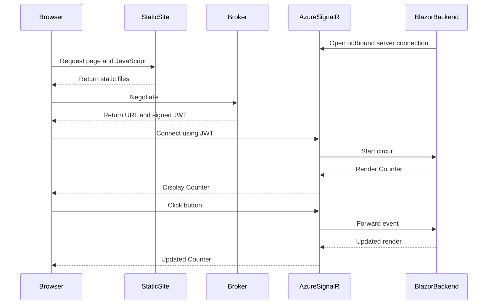

# Private Blazor Server via Azure SignalR

A small demonstration of running **Blazor Server components without exposing the Blazor application server to inbound HTTP traffic from the public internet**.

This demo requires an Azure SignalR connection string.  When you launch the application with ```aspire run``` you will be prompted to enter the connection string and optionally save it to your user secrets.

The goal is to substantially reduce the internet-facing attack surface of a Blazor Server application. Instead of exposing the ASP.NET Core backend through a public web endpoint, the browser loads a static page and communicates with the backend through **Azure SignalR Service**. The backend establishes its own outbound connections to that service.

This repository deliberately uses **three small, independent .NET file-based apps** so the architecture is easy to see and experiment with. No custom Blazor transport or framework modifications are needed.

## How it works

The sequence below shows the complete path from loading the static page to clicking the Counter button. **Read it from top to bottom.**


Note over Browser,Backend: No direct browser-to-backend HTTP requests

The browser contacts only the **static site**, **broker**, and **Azure SignalR Service**. The broker generates a connection token but does not carry form traffic. The Blazor backend makes its own **outbound** connection to Azure SignalR; the service then relays interactive messages over that existing connection. The browser never needs an HTTP route to the backend.

## The three applications

### 1. Static website — `static.cs`

This is a deliberately minimal static file server. It uses Kestrel only to serve files from **`staticwwwroot/`**, which is configured as its web root.

- `staticwwwroot/index.html` contains the test page and the JavaScript that starts Blazor and creates the Counter component.
- `_framework/blazor.server.js` supplies the standard Blazor Server browser bootstrap code.

There is no Blazor application running in this server. It represents **any static hosting platform**: the same page and assets could be published to a CDN or a service such as **Cloudflare**, without requiring .NET on the static host.

For the demo, the static website runs at `http://localhost:5101`.

### 2. Negotiation broker — `broker.cs`

The broker is a separate, minimal HTTP API. It handles `POST /_blazor/negotiate` and returns an **Azure SignalR client URL and a signed JSON Web Token (JWT)**. The JWT authorizes a browser connection to Azure SignalR; it is not application-user authentication. This demonstration intentionally allows anonymous public users.

Two interchangeable implementations are included:

- **`broker.cs`** uses Microsoft's `Microsoft.Azure.SignalR.Management` package to generate the negotiation response.
- **`broker_alternate.cs`** shows the same process at a lower level, using built-in .NET APIs to construct and sign the JWT directly, without the Azure SignalR NuGet package.

When generating JWTs note that Azure SignalR authentication relies on JWTs with time-based validity. Ensure the local system clock is synchronized. If connections return HTTP 401, inspect the WWW-Authenticate response header, verify the current connection string, and allow for potential credential changes during key rotation.

The alternate version makes an important point: **the broker is not a Blazor or SignalR application server**. It is a small token issuer, and the same functionality could be implemented in almost any language or platform, including a **Cloudflare Worker** or an **Azure Function**.

After negotiation, browser traffic goes directly to Azure SignalR Service, not through the broker.  The broker is only required to generate a valid token permitting the user's web browser to connect to Azure SignalR service.

For the demo, the broker runs at `http://localhost:5102`. Aspire starts `broker.cs` by default; `broker_alternate.cs` is provided for comparison.

The broker.cs and broker_alternate.cs examples were written in C#.  But a similar cloudflare worker would look like this:

```js
const encoder = new TextEncoder();
const origin = "https://www.example.com"; // Static website origin

// JWTs use Base64URL rather than ordinary Base64.
function base64url(bytes) {
    return btoa(String.fromCharCode(...bytes))
        .replaceAll("+", "-").replaceAll("/", "_").replace(/=+$/, "");
}

export default {
    async fetch(request, env) {
        if (new URL(request.url).pathname !== "/_blazor/negotiate")
            return new Response("Not found", { status: 404 });

        // Allow requests from our static website.
        const cors = {
            "Access-Control-Allow-Origin": origin,
            "Access-Control-Allow-Methods": "POST, OPTIONS",
            "Access-Control-Allow-Headers": "content-type"
        };

        if (request.method === "OPTIONS")
            return new Response(null, { status: 204, headers: cors });

        if (request.method !== "POST")
            return new Response("Method not allowed", { status: 405, headers: cors });

        // The actual Blazor hub name is "componenthub".
        const url = `${env.SIGNALR_ENDPOINT.replace(/\/+$/, "")}/client/?hub=componenthub`;

        // Construct the JWT header and payload.
        const now = Math.floor(Date.now() / 1000);
        const header = base64url(encoder.encode(JSON.stringify({ alg: "HS256", typ: "JWT" })));
        const payload = base64url(encoder.encode(JSON.stringify({
            aud: url, iat: now, exp: now + 3600
        })));

        // Sign the JWT with the Azure SignalR access key (HMAC-SHA256).
        const content = `${header}.${payload}`;
        const key = await crypto.subtle.importKey(
            "raw", encoder.encode(env.SIGNALR_ACCESS_KEY),
            { name: "HMAC", hash: "SHA-256" }, false, ["sign"]
        );
        const signature = base64url(new Uint8Array(
            await crypto.subtle.sign("HMAC", key, encoder.encode(content))
        ));

        return Response.json({
            url,
            accessToken: `${content}.${signature}`
        }, {
            headers: { ...cors, "Cache-Control": "no-store" }
        });
    }
};
```
The above code would need a cloudflare SIGNALR_ENDPOINT environment variable like https://your-service.service.signalr.net.  It would also need a cloudflare secret SIGNALR_ACCESS_KEY which is the AccessKey value from the Azure SignalR connection string. If the Worker is deployed under the same hostname as the static website, CORS handling isn't actually necessary and can be removed.

Assuming Cloudflare routes /_blazor/negotiate to the Worker, the browser's existing Blazor startup code then only needs to point to the Worker's negotiation route. For example the javascript in the index.html file could be changed to simply:
```js
configureSignalR: builder => builder.withUrl("/_blazor")
```

### 3. Blazor backend — `components.cs`

This is an otherwise conventional **Blazor Server** application. It registers its SignalR-backed Blazor hub and uses Azure SignalR Service for the connections to browsers.

The `Components/` directory contains `Counter.razor`, a normal interactive Razor component. The backend registers it as a **JavaScript root component**, allowing the static page to create it through `Blazor.rootComponents.add(...)`.

The component executes on the backend: clicks, rendering, state and logs work as they do in a normal Blazor Server application. OpenTelemetry instrumentation also demonstrates that component activity remains observable without public inbound HTTP requests.

**The key property is that the backend needs no public inbound HTTP connection from the browser or broker.** It initiates outbound connections to Azure SignalR, which relays the Blazor messages. For example, it could be deployed on a private network with no public ingress, or behind network controls that block inbound internet access. Private-only HTTP endpoints, such as health checks, can still be retained if required.

For the local demo, Kestrel listens at `http://localhost:5103`, but the static page does not contact that address.

## Run the demo

You will need:

- The **.NET 11 SDK** and **Aspire CLI**.
- An existing **Azure SignalR Service** instance and its connection string.

From the repository directory, run:

```sh
aspire run
```

`apphost.cs` starts the three applications and passes the Azure SignalR connection string to the broker and backend. Aspire prompts for the secret when necessary and can save it in local user secrets.

Then open **http://localhost:5101** and click the Counter button. You can also use the **Aspire dashboard** to inspect application logs and telemetry from the backend component.

The applications are intentionally small, with no traditional solution or project files. The demo uses .NET 11 file-based app features, including `#:include` for the Razor component. **The hosting architecture itself is not specific to .NET 11** and can be implemented with .NET 10 or later using the appropriate project structure.

## Why this matters

In a conventional public Blazor Server deployment, the ASP.NET Core application has a publicly reachable HTTP endpoint. In this design, the public-facing pieces are a static website, a minimal token broker and Microsoft-managed Azure SignalR Service. The application server itself does not need to be reachable through HTTP from the internet.

That **reduces the externally reachable HTTP attack surface** while retaining normal interactive Blazor Server components. It does **not** mean the application stops processing untrusted input: public users can still enter form information which is sent through Azure SignalR messaging service; the server retrieves these messages via its separate connection to the SignalR service.  However the need for a public HTTP endpoint on the app server is completely eliminated. Normal secure development, updates, input validation and monitoring remain important.

## Azure SignalR configuration options

This demo works with a basic Azure SignalR Service resource. The following options illustrate ways to balance simplicity, network isolation and operational overhead; they are not requirements for running the example.

### Service mode and tiers

- **Default mode** is used because `components.cs` hosts the Blazor hub and circuits, while Azure SignalR relays messages between the server and browsers. **Serverless mode** is for applications without a hub server; it isn't appropriate here, even if the *broker* runs in an Azure Function.
- The **Free** tier works for the demo. **Standard and Premium** support private endpoints; **Premium** provides the Application Firewall described below. These additional controls won't all be available on a Free resource.

### Networking and private hosting

Azure SignalR distinguishes browser (`ClientConnection`) and backend (`ServerConnection`) traffic. Its network access rules can, for example, **allow public client connections but deny public server connections**, permitting the latter only through an approved private endpoint.

An Azure App Service backend could then disable **public inbound access** and use **VNet Integration** to connect outbound to Azure SignalR through **Private Link**. Private DNS routes its normal SignalR hostname to the private endpoint. The backend can still retain private-only HTTP endpoints such as health checks. Alternatively, server connections can use the public Azure SignalR endpoint.

For public forms, **Azure SignalR's own public access remains enabled** so browsers can connect; request-type access rules constrain what that public endpoint accepts. If an Entra-based broker was used instead of using local token generation from the keys, using the Azure SignalR REST API would also need an allowed `RESTAPI` route, potentially over Private Link.

### CORS and Application Firewall

**CORS:** Azure SignalR allows all origins (`*`) by default, but can limit browser origins to the static website's domain. The broker has a separate CORS policy. CORS is a browser control, **not a substitute for connection tokens** or protection against non-browser clients.

**Application Firewall (Premium):** This built-in feature can restrict concurrent client connections and inbound message throughput by **user ID, JWT signature or custom token claim**. It also supports a maximum connection lifetime. In an anonymous system, someone can obtain fresh tokens, so rate limiting at the broker or CDN may complement these rules.

### Access keys or Microsoft Entra ID

The demo uses **connection-string access keys**. `broker.cs` uses Microsoft's SDK, while `broker_alternate.cs` signs the browser JWT directly. Both can issue tokens **locally without contacting Azure SignalR or Entra ID for each request**. This is simple and portable (including to Cloudflare Workers), but the broker must securely hold and rotate a broadly privileged signing key.

Alternatively, **Microsoft Entra ID and Azure RBAC** allow more granular identities and permissions. A broker could use an app registration/service principal or, when hosted on Azure, a **system-assigned managed identity** (no separate app registration needed). A custom role can permit client-token issuance, such as `Microsoft.SignalRService/SignalR/auth/clientToken/action`, while the backend has a separate identity with the `SignalR App Server` role. This avoids sharing a broad signing key but adds role and network configuration, plus an API call to obtain each client token. Disabling local access-key authentication is another available option.

Either approach supports **anonymous public users**; the Azure SignalR token authorises the connection and does not require users to sign in.
